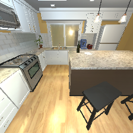
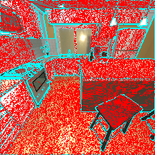

# T00 可行性测试报告（执行完成，验收条件未满足）

**执行结论：Hopper H200 可以完成真实 CloudRendering 和短程训练更新，但 T00 的验收条件未满足。** 原始恢复 19/20 失败；新增 B/C 诊断分别 20/20、19/20 失败，最大 RGB 通道差均为 3，零差标准未调整。官方单 GPU 基线在首次 actor AdamW 更新时 OOM，完整更新数为 0。独立 `critic_offload` 变体完成 6 个完整更新后达到预设 60 分钟训练限时，exit 124，因此没有满足“exit 0 且至少 20 步”。

本报告引用原始 JSON、日志和日志化汇总，不覆盖失败记录。诊断程序、证据汇总或 provenance audit 成功，不代表实验验收通过。恢复根因及阴影归因仍未确定；新账号空 scratch 的完整重建也尚未验证。所有本轮作业已结束，最终总用量和排队时间见 §7；报告推送后停止 GPU 工作，等待 Claude 审查。

## 1. 执行范围、存储与预检

任务限单张 H200、累计不超过 6 GPU·小时。远程仓库为 `/home/svu/e1583364/CVPR2027/cvpr2027`（结果记录的实际挂载路径为 `/nfs/home/svu/e1583364/CVPR2027/cvpr2027`）；初始代码已提交并推送。安装和 GPU 工作均在 PBS 分配中执行，登录节点只进行轻量预检、代码管理、提交、查询和已有证据汇总。实验通过 `scripts/run_logged.py` 记录命令、commit、退出状态及指标哈希。

| 项目 | 已知事实及限制 |
| --- | --- |
| home | 配额 40 GB，仅存代码及需要提交的小型日志、结果、图。配额工具曾报错，不将旧缓存用量当作当前精确用量；补查原始记录为 `logs/runs/t00_storage_followup.log`。 |
| scratch | 配额 1 TB；任务根目录 `/scratch/e1583364/cvpr2027`。定期清理/保留规则尚未确认。原有目录和失败安装目录均保留。 |
| 环境与大文件 | Miniforge、conda 环境/包缓存、pip、HF、torch、triton、CUDA cache、Ray、TMPDIR、W&B、模型、训练输出、checkpoint、AI2-THOR 均放 scratch。`~/.ai2thor` 和 `~/.conda` 软链只在不存在或目标已正确时建立/接受，不覆盖其他现有内容。 |
| 模块 | 已确认 CUDA `cuda12.4/toolkit/12.4.1`、`cuda12.9/toolkit/12.9.1`；预检未发现 conda/Vulkan 模块。原始 `module avail` 位于 `results/t00_login_preflight.json:config.observations` 和 `logs/runs/t00_login_preflight.log`。Vulkan 按系统库、模块、conda-forge 顺序检查，不使用 sudo。 |
| 网络 | 登录节点检查与 `hpc autox` 原始输出同在上述 preflight JSON/日志；计算节点的 PyPI、GitHub、Hugging Face 响应均为 200，已核对 `logs/compute_network.txt`。 |

项目为 `CFP04-SF-125`，Express 路由队列为 `autox`。一 GPU 提交模板使用 `-P CFP04-SF-125 -q autox -l select=1:ngpus=1`，站点自动配置 12 CPU / 225 GB，walltime 由参数传入。作业先进入仓库目录，加载 scratch 路径，再通过 run_logged 执行保存的命令。唯一 payload、PBS 脚本和 qsub stdout/stderr/returncode 均留档；不使用 `qsub -V`，不覆盖 PBS 的 `CUDA_VISIBLE_DEVICES`。

CPU-only 探测曾请求 `select=1:ncpus=4:mem=32gb:ngpus=0`，但站点 hook 将 **706116 改为 1 GPU / 12 CPU / 225 GB** 并路由到 `smallx`。因此 `cpu_only` 仅表示提交意图，实际消耗仍按一张 GPU 计算；不由矛盾的队列 charge-rate 字段推断免费。

## 2. 环境与实际兼容性修复

固定来源为 VAGEN `vagen-legacy` commit `4e2976d87c0f92c97f9a820803e71908cde5fb71` 和 JamesKrW/verl `vagen-legacy` commit `3f55021e08b98315213e10d10b709c7f6bbe84f7`。源码位于 scratch，仓库内 `third_party/VAGEN` 是不纳入版本控制的软链。环境为 scratch 下 Miniforge 24.11.3-2 / Python 3.10 / `cvpr2027`；脚本分 `--bootstrap`、`--render`、`--full`，部分渲染环境不冒充完整安装。

渲染依赖为 `ai2thor==5.0.0`、`numpy==1.25.1`，监测使用 `psutil==6.1.1`、`nvidia-ml-py==12.560.30`。完整栈保留固定 verl/VAGEN 的安装顺序及 torch 2.6.0、vllm 0.8.2、flash-attn 2.7.4.post1。下列修复均对应真实失败，原日志和结果保留。

| 观察到的失败 | 最小修复与已观察结果 |
| --- | --- |
| 706116：Miniforge 继承 `CONDARC`，与安装器内部 `--no-rc` 冲突，libmamba 中止。 | 仅对子安装器清除冲突配置/旧激活变量；保留失败的 `miniforge3`，改用新前缀 `miniforge3-24.11.3-2`。706118 完成渲染环境，后续真渲染成功。 |
| 706124：当前 PyPI 缺失 vllm 所需 `xgrammar==0.1.16` 分发包。 | 从官方 v0.1.16 commit `989222175c2a30fb7987d8bcce35bec1bf6817f2` 及其固定子模块构建，`pip install --no-deps`，验证 metadata 仍为 0.1.16；706127 的该阶段成功。[官方 release](https://github.com/mlc-ai/xgrammar/releases/tag/v0.1.16)、[源码安装说明](https://github.com/mlc-ai/xgrammar/blob/v0.1.16/docs/start/install.rst)。 |
| 706127：FlashAttention 隔离构建报 `ModuleNotFoundError: torch`。 | 在已安装 torch 后，以 `--no-build-isolation` 预装同一 `flash-attn==2.7.4.post1`，随后运行未改动的上游 `install.sh`。706131 完整安装脚本成功；未替换版本。 |
| 706152：Navigation server 经 gym_sokoban 导入 `pkg_resources` 失败，setuptools 84 已移除该模块。 | 激活环境后固定 `setuptools==80.9.0`；官方版本支持 Python >=3.9 且包含该模块。[版本元数据](https://github.com/pypa/setuptools/blob/v80.9.0/pyproject.toml)、[模块源码](https://github.com/pypa/setuptools/blob/v80.9.0/pkg_resources/__init__.py)。706199 中的修复子步骤成功。 |

渲染环境的 freeze / `pip check` 在 `logs/runs/t00_setup_render_retry1.log`；full 成功记录在 `logs/runs/t00_setup_full_retry2.log`，修复 commit `eb55740`。`results/t00_setup_pkg_resources.json` 记录后续兼容性修复内部耗时 **148.85895414010156 秒**、exit 0，commit `a3f45e2f958663ba2f63448d9da56dd4e233c2e7`、`git_dirty=false`。已核对安装日志确认 Navigation 注册、server/torch/flash_attn/vllm 导入及 `pip check` 均成功；active pip freeze 为 setuptools 80.9.0，不能把 conda explicit 的旧记录当作当前导入版本。安装/import 成功仍不等于模型检查或训练成功。上游未固定的传递依赖也意味着“脚本已存在”不能替代新账号从零重建验证。

本次是现有账号的累计增量安装与修复，**未做全新账号、空 scratch 的完整复建验证**。脚本固定关键源码与部分依赖，但没有完整锁定 Python 补丁版本、所有传递依赖、系统工具链或模型 snapshot revision。主要环境、大文件和已配置缓存路径指向 scratch；这依赖启动进程加载 `scratch_env.sh`，不是文件系统隔离，也未完成全进程写入路径审计。`setup_env.sh --full` 末尾的 CUDA UUID、唯一 GPU 和 Qwen 架构检查需要单 GPU PBS 分配；它不等于权重或 Unity 程序已经预下载完毕，首次运行仍依赖相应下载源可达。已有目录冲突时脚本保守停止，scratch 长期保留规则仍未知。

## 3. 原始渲染、恢复与物体操作

PBS `706121.hopper-m-02`，主机 `hopper-15`，AI2-THOR 5.0.0，GPU NVIDIA H200、`143771 MiB`，MIG Disabled。已核对 PBS GPU UUID 与 Vulkan 设备 UUID，使用真实 CloudRendering。两项渲染结果 commit 均为 `3bf229de0177ac7141e0a474671cbea21e9d6eb4`、`git_dirty=false`。

`results/t00_thor_checks.json`：FloorPlan1、224×224、`config.seed=0`、Ultra、gridSize=0.1、FOV=100、visibilityDistance=10；exit 1，wrapper 耗时 107.5 秒。`_meta.seed` 为 null，实际脚本种子以配置字段为准。

| 检查 | 实际结果 |
| --- | --- |
| RGB | `logs/thor_smoke.png`，真实 224×224×3 帧。 |
| 确定性恢复 | 20 个状态各恢复两次；19/20 失败，最大通道差 3；仅 state 8 为零差。 |
| 物体清单 | 全部状态两次恢复均保留原始物体 name 清单。 |
| 实例分割 | 11 个非空实例 mask，7 个 ID 匹配 metadata；比例 0.6363636363636364。 |
| 单物体移动 | 10 次 x 方向 +0.05 m 目标；位置误差中位数 1.192092896618036e-08 m，最大 4.768371586472142e-08 m。 |
| 连带移动 | 其他物体移动超过 1 cm 的计数合计 0；没有记录物体丢失。 |

未匹配 ID 是 Ceiling、StandardCounterHeightWidth、UpperCabinets、Wall。官方源码允许分割包含非 SimObj 结构对象，而物体 metadata 枚举 SimObj；这不自动证明 mask 错误（[ImageSynthesis](https://github.com/allenai/ai2thor/blob/5.0.0/unity/Assets/Scripts/ImageSynthesis/ImageSynthesis.cs#L270)、[metadata](https://github.com/allenai/ai2thor/blob/5.0.0/unity/Assets/Scripts/BaseFPSAgentController.cs#L1776)）。脚本把匹配率 1 作为完成条件过严；原始 7/11 保留，19 个恢复失败独立构成验收失败。

失败例：state 0 最大差 3、不同像素 23054；state 11 最大差 2、不同像素 29860；state 18 最大差 1、不同像素 55。成对图片在 `logs/runs/t00_thor_checks/restore_failures/state_XX_restore_1.png` 与 `_2.png`。原始结果保存了输入完整 pose，没有保存恢复后实际 transforms，因此不能由该次记录确定原因。TeleportFull 的 floor adjustment 只是排查方向；默认 agent 关闭 PostProcessVolume/Layer，也没有依据将问题归于 TAA、dithering 或 H200 噪声（[TeleportFull](https://github.com/allenai/ai2thor/blob/5.0.0/unity/Assets/Scripts/PhysicsRemoteFPSAgentController.cs#L1542)、[初始化](https://github.com/allenai/ai2thor/blob/5.0.0/unity/Assets/Scripts/PhysicsRemoteFPSAgentController.cs#L32)）。位姿误差小不等于像素确定性或无穿模通过；结果明确 `physical_validity_claim=false`。

## 4. 三组恢复诊断

PBS 706199，主机 `hopper-21`，H200，AI2-THOR 5.0.0，Unity build `f0825767cd50d69f666c7f282e54abfe58f1e917`；三组均为 FloorPlan1、224×224、seed 0、Ultra、instance segmentation 开启，按相同状态生成顺序完成 20 个比较。阈值始终为零差。

| 模式 | 实际操作 | 零差失败数 | 最大通道差 | wrapper 秒 |
| --- | --- | ---: | ---: | ---: |
| A `no_reset` | 初始状态设置后 PausePhysicsAutoSim，连续两次完整渲染 Pass；两帧之间不 reset、不恢复 pose。 | 0/20 | 0 | 29.9 |
| B `metadata` | 两次 reset + 完整 SetObjectPoses + TeleportFull，默认物理设置，记录实际 metadata。 | 20/20 | 3 | 43.1 |
| C `paused` | 每次 reset 后先 PausePhysicsAutoSim，再 SetObjectPoses、TeleportFull；恢复后不增加 Pass。 | 19/20 | 3 | 43.7 |

A 的 commit 为 `8eaecd1693022de58e46c544220936bc94a2f975`，B/C 为 `c2e81573205aa8be6be8a249d593752d2ffb43ce`；均 `git_dirty=false`、`diagnostic_completed=true`、exit 0。已核对两 commit 间诊断源码无差异。A 证明该条件下连续不重置采样可获得相同 RGB，**不替代恢复验收**；B/C 仍失败，进程 exit 0 不表示图像通过。

下表直接引用已日志化的 `t00_restore_diagnostic_summary.json:metrics.modes`，每组 20 个比较；比例显示六位小数，完整精度保留在 JSON。不同像素指任一 RGB 通道发生变化的像素数。

| 模式 | 不同像素 min / median / max | 合并差异像素中落在边界带的比例 | 按差异像素数加权的均匀空间基准 |
| --- | ---: | ---: | ---: |
| A `no_reset` | 0 / 0 / 0 | null（没有差异像素） | null |
| B `metadata` | 6618 / 22446 / 29846 | 0.160614 | 0.191525 |
| C `paused` | 0 / 22220 / 28837 | 0.179598 | 0.212191 |

边界带来自两帧实例掩码边界的并集，含图像边界，按 Chebyshev 距离扩张 1 像素。合并比例为各案例“带内差异像素数之和 / 差异像素数之和”；基准为各案例边界带面积比例按差异像素数加权。这是描述性位置统计，不能证明边缘、阴影或任何渲染机制是原因；**shadow attribution 保持 unknown**。

两次 capture 的已报告 transforms 完全一致数为 A 20/20、B 17/20、C 10/20；B、C 的 agent 与 camera 报告字段均为 20/20 exact。更广的已采集状态字段 `observed_state_fields_exact` 在 B 为 12/20、C 为 4/20，不能把 transforms exact 写成全部 metadata exact。B 的 case 0 已报告 transforms/state fields exact，却仍有 23567 个不同像素、最大差 3；C case 0 同样 exact，却有 28837 个不同像素、最大差 3。metadata 一致不证明隐藏 Unity/光照状态完全相同。

`source_to_capture_transforms` 是原始状态与恢复结果的比较，不能混作两次 capture 的比较：B/C 各 40 次原始状态→capture 的 `observed_transforms_exact` 均为 0/40，最大物体位置差均为 `9.610960183499514e-07 m`；两次恢复结果彼此接近或相同，不等于精确回到源状态。标准 metadata 不提供的物理暂停标志保持 null，`isSceneAtRest` 不等于已读到内部暂停状态。C 只暂停自动物理；`TeleportFull(forceAction=False)` 内部的 CharacterController 手动重力仍可能执行，因此 C 失败不能证明所有物理影响已经排除。所记录的两次 capture agent/camera 字段相同，也不能证明整个 Unity 状态一致。

两次 capture 间，B/C 的最大物体位置差分别为 `2.384185791015625e-07 m` 与 `2.6656007498500226e-07 m`，最大原始 Euler 分量差均为 `1.8189894035458565e-12°`；均来自汇总的 `pair_transforms.deltas`，没有引入接受误差。已检查 B case 0 的原图、差异掩码与叠加图，差异遍布表面内部，并不局限于实例边界。边界带不覆盖全部材质或阴影边界，不能由带外差异认定阴影原因。

B case 0 的原图与差异位置叠加图如下。红色表示任一通道发生非零变化的位置，不表示变化幅度很大；青色表示实例边界，发生变化的位置优先显示红色。

| 原始 RGB | 差异位置与实例边界 |
| --- | --- |
|  |  |

只读源码复核提供一个待检验候选：metadata 先记录物体根节点 position/Euler，随后读取 OBB/AABB；边界框缓存重算可能临时解除再恢复子物体父子关系，OBB 还会克隆物体计算边界框，之后才进行 RGB 渲染（[metadata 顺序](https://github.com/allenai/ai2thor/blob/f0825767cd50d69f666c7f282e54abfe58f1e917/unity/Assets/Scripts/BaseFPSAgentController.cs#L1607)、[缓存与父级操作](https://github.com/allenai/ai2thor/blob/f0825767cd50d69f666c7f282e54abfe58f1e917/unity/Assets/Scripts/SimObjPhysics.cs#L179)、[metadata→RGB](https://github.com/allenai/ai2thor/blob/f0825767cd50d69f666c7f282e54abfe58f1e917/unity/Assets/Scripts/AgentManager.cs#L918)）。本次没有采集子 renderer 矩阵、完整层级 scale/quaternion 或缓存重算轨迹，也未证明这些操作在该案例导致差异，因此它只是供 Claude 设计下一轮隔离检查的假设。未找到 Reset 自动随机化材质或光照的明确证据；CloudRendering 创建主 RGB render texture 时固定 MSAA=4，单独降低 quality 不能证明已禁用该抗锯齿路径。

跨案例统计已完成，恢复根因仍未知。三个原始结果与汇总均保留来源哈希；每组 `logs/runs/<诊断名>/case_XX/` 保存 raw_metadata、RGB、mask、差异图和边界叠加图。诊断不覆盖原始失败结果。

## 5. 渲染吞吐量

`results/t00_thor_throughput.json`：exit 0、status passed、97.7 秒，commit 同原始渲染。单实例每档执行 200 次真实 MoveAhead/MoveBack + 同步 RGB 接收；255×255 为官方 legacy Navigation 默认分辨率。

| 分辨率 | 逐帧 FPS 中位数 | 总帧数 / 测量墙钟 FPS |
| --- | ---: | ---: |
| 224×224 | 106.466 | 95.579 |
| 255×255 | 103.503 | 92.477 |

并发各实例均执行 200 次。CPU 为各实例 Python worker + Unity 进程树 user/system CPU 秒除以测量墙钟秒，再对实例取均值；1.0 core 表示一个核心持续占满。括号为实例范围；显存是 NVML 采样峰值。

| 分辨率 | K | 合计 FPS | 平均每实例 CPU core（范围） | 每实例显存峰值 MiB（范围） | 整卡采样峰值 MiB |
| --- | ---: | ---: | --- | --- | ---: |
| 224×224 | 1 | 94.353 | 1.137（1.137–1.137） | 270.117–270.117 | 902.438 |
| 224×224 | 4 | 343.869 | 1.116（1.109–1.123） | 270.117–270.117 | 1770.188 |
| 224×224 | 8 | 542.515 | 0.964（0.949–0.987） | 270.117–270.117 | 2927.188 |
| 224×224 | 11 | 573.311 | 0.785（0.773–0.795） | 270.117–270.117 | 3794.938 |
| 255×255 | 1 | 87.861 | 1.116（1.116–1.116） | 270.117–270.117 | 902.438 |
| 255×255 | 4 | 318.892 | 1.100（1.092–1.112） | 270.117–270.117 | 1770.188 |
| 255×255 | 8 | 514.093 | 0.955（0.943–0.983） | 270.117–270.117 | 2927.188 |
| 255×255 | 11 | 539.686 | 0.760（0.748–0.773） | 270.117–270.117 | 3794.938 |

数值与日志化 `t00_interim_summary.json:metrics.throughput.rows` 一致，显示三位小数。采样间隔 0.5 秒、测量窗口约 2–4 秒，不能保证捕获瞬时峰值。初始化、下载、场景加载与 warm-up 不计入帧率；动作沿已验证可通行边反复移动 0.5 m，不代表全部场景或动作的平均负载。原始 JSON 保存逐帧耗时、各实例资源和采样错误。

K=11 表示 **11 个模拟器实例，不是 11 次独立训练**。255 分辨率 K=11 的纯模拟总 FPS 为 539.686；已测得 VAGEN rollout 总耗时，但仍缺实际每 step 新增 RGB 帧数，以及模型生成与渲染各自耗时、资源竞争的可归因观测，不能认定纯模拟帧率已足够支持训练，也不能给出已证实的独立训练并发数。

## 6. VAGEN Navigation 训练与失败观测

使用官方 **VAGEN-Base Navigation**，不是 VAGEN-Full；模型为 `Qwen/Qwen2.5-VL-3B-Instruct`，actor/critic 均为官方 3B 配置，完整配置 `trainer.total_training_steps=300`。仅作一 GPU 拓扑适配（trainer GPU 4→1、rollout TP 4→1、Navigation server device 对应分配卡）及缩短步数。短跑配置 21 对应固定 legacy 循环至少 20 个实际更新的目标，验收以完成日志计数为准；其余 batch、奖励、优化器、验证与 checkpoint 配置保留，W&B offline，模型与输出在 scratch。

首次 706152 在 `start_navigation_server` 阶段因 `pkg_resources` 缺失退出。706199 的 retry1 经过 setup/import 检查后进入 `training`，仍 exit 1，完成更新数 **0**。在底层日志中定位为 vllm 0.8.2 将 PBS 提供的 `GPU-...` UUID 传入 `int(...)` 触发 ValueError，并向模型架构检查路径传播；不能解释为模型不支持或 OOM。

706212 的 `results/t00_setup_vllm_uuid.json` 记录兼容性修复 exit 0、内部耗时 **107.97329136996996 秒**，commit `a9e0a8285dacc11ba8c902bfbfcfb47c7e822771`、`git_dirty=false`。已核对 `logs/runs/t00_setup_vllm_uuid.log`：PBS 的 `CUDA_VISIBLE_DEVICES` 保持不变，同一 UUID 经 NVML 取索引，CUDA UUID 交叉检查一致，torch 识别唯一分配卡，Qwen 架构检查成功。

兼容补丁由 `src/tools/patch_vllm_uuid.py` 实施，仅接受固定 vllm 0.8.2 的已知源文件 SHA，保留原文件备份，再为完整 `GPU-...` UUID 添加 NVML 解析和 UUID 回验；不改模型结构，也不把 PBS UUID 替换为猜测的整数。原 `vllm/platforms/cuda.py` SHA-256 为 `3315afae41183ff0628982fdb08ef3997ab1694a2841a25381cdb2f70b31dae6`，补丁后为 `1d27d2b5d25dbf8c511f39b7031f2d90c30fd3b5c7f052ea17a7c1138bc57c2b`。这些是运行兼容改动，应与官方训练超参数的两处缩短/单卡改动分开审查。

随后 retry2 完成真实 Navigation validation 并生成 responses，但在 **step 1 的 actor AdamW `foreach_sqrt` 更新路径发生 CUDA OOM**，作业自然失败。`results/t00_vagen_smoke_retry2.json` 的 source/training command/wrapper exit 均为 1，`last_stage=training`、`completed_training_steps=0`、`completed_step_timings={}`、`acceptance_passed=false`；commit 同上且 `git_dirty=false`。该结果证明本次官方配置的一 GPU 基线在首次 actor 更新时显存不足，不代表所有 H200 配置均不可运行，也不能把已完成 validation 或部分 step 当作完整更新。

以下原样引用两个失败结果的真实采样。retry1 覆盖初始化至 UUID 错误，retry2 覆盖初始化、validation 和未完成的首次训练更新；均不是成功训练的稳态资源或完成步骤耗时。

| 记录项 | retry1 | retry2 |
| --- | ---: | ---: |
| GPU 采样峰值 MiB（唯一分配整卡） | 38537.0 | 142486.0 |
| 进程树 CPU 中位数 % | 46.80477326895398 | 167.7861058354544 |
| 进程树 CPU 峰值 % | 343.81190243188234 | 756.2821775246493 |
| 进程树 RSS 峰值 bytes | 29183131648 | 185039642624 |
| 资源采样数 | 29 | 86 |
| 受监测命令耗时秒 | 148.65038054797333 | 970.1776570180664 |
| 外层 run_logged 耗时秒 | 159.4 | 985.2 |

CPU 100% 表示一个核心；RSS 按观察到的进程求和，可能重复计共享页；显存为采样峰值。retry1 commit 为 `4e46ee46334b1059bf66f0b994aeb2411a9e5a9a`。两次结果的 `train.log`、`resources.jsonl`、`config.json` 哈希均在各自 `evidence_files`。

首次、retry1、retry2 均无完整更新，step、rollout、actor/critic/参数更新时间及完整训练小时估算继续为 null。`actual_new_rgb_frames_per_train_step`、`required_render_fps` 也为 null；模型 turn 不是 Unity 新渲染帧数，不能用初始化耗时、失败命令总耗时或纯渲染 FPS 补齐。这些基线失败不产生完整训练成本估算。后文只对独立省显存变体中实际完成的步骤做任务要求的条件外推。

按照 T00 对实际 OOM 后省显存尝试的许可，后续独立实验选择 `T00_MEMORY_VARIANT=critic_offload`，仅将官方已有的 `critic.model.fsdp_config.param_offload=False` 与 `critic.model.fsdp_config.optimizer_offload=False` 改为 `True`。默认 `none` 继续保留基线行为，未知选项拒绝；manifest 记录 `memory_variant` 和相对官方的额外差异。batch size、模型、奖励、优化器超参数及其他设置不变。官方 launcher 已有这两个 [critic offload 选项](https://github.com/mll-lab-nu/VAGEN/blob/4e2976d87c0f92c97f9a820803e71908cde5fb71/scripts/examples/vagen_base/navigation/run.sh#L64)；固定 verl 的 [critic 更新路径](https://github.com/JamesKrW/verl/blob/3f55021e08b98315213e10d10b709c7f6bbe84f7/verl/workers/fsdp_workers.py#L821) 在返回前按配置卸载参数和优化器，trainer 随后才执行 [actor 更新](https://github.com/mll-lab-nu/VAGEN/blob/4e2976d87c0f92c97f9a820803e71908cde5fb71/vagen/trainer/ppo/ray_trainer.py#L1195)。这为省显存尝试提供源码依据，不证明本次可成功或 225 GB 主机内存足够。706227 越过基线的首次 actor AdamW OOM 点并完成 6 个完整更新；随后按预先设置的训练限时退出，基线 OOM 结果保持不变。

`results/t00_vagen_smoke_critic_offload.json`：主机 `hopper-16`，commit `60b297b50af91925613b0afcbafa7cd765fc114d`、`git_dirty=false`。训练 command / wrapper exit 均为 124，`acceptance_passed=false`；`resources.jsonl` 的完成记录为 `timed_out=true`、`interrupted_signal=null`，对应预设 `watchdog_seconds=3600`。没有执行 qdel 或取消 PBS 作业。第 7 步只有开始/部分运行记录，不计入完整更新。

| 完整 step | 总耗时秒 | rollout 秒 | critic 更新秒 | actor 更新秒 |
| ---: | ---: | ---: | ---: | ---: |
| 1 | 646.209 | 252.737 | 123.054 | 128.892 |
| 2 | 502.767 | 216.108 | 89.563 | 92.390 |
| 3 | 472.152 | 191.966 | 91.679 | 91.336 |
| 4 | 508.470 | 219.556 | 92.307 | 96.477 |
| 5 | 467.720 | 186.334 | 93.311 | 86.537 |
| 6 | 463.126 | 191.014 | 91.074 | 82.893 |

以上字段直接来自最终 JSON 的 `completed_step_timings`，其中保留原始 train.log 行号。最终汇总如下；各占比是逐 step 比值的中位数，不是两个中位数相除。

| 最终观测 | 数值 |
| --- | ---: |
| 完成更新数 | 6 |
| step 耗时中位数秒 | 487.4595 |
| rollout 耗时中位数秒 | 204.037 |
| actor 更新中位数秒 | 91.863 |
| critic 更新中位数秒 | 91.993 |
| 同一步 actor+critic 更新之和的中位数秒 | 182.48399999999998 |
| rollout / step 比值中位数 | 0.4095108445057607 |
| 参数更新 / step 比值中位数 | 0.3800785446275543 |
| 整卡显存采样峰值 MiB | 138442.0 |
| 进程树 CPU 中位数 % | 150.38497996135405 |
| 进程树 CPU 峰值 % | 947.5083599905923 |
| 进程树 RSS 采样峰值 bytes | 321056661504 |
| 资源采样数 | 340 |
| 受监测命令耗时秒（含限时清理） | 3614.4978935549734 |
| 外层 run_logged 耗时秒 | 3639.5 |

PBS 的最终资源字段还记录 `resources_used.mem=279490144kb`、`resources_used.cpupercent=410`、`resources_used.cput=02:52:11`；请求为 `Resource_List.mem=225gb`，exec_vnode 为 `mem=235929600kb`。**PBS 报告的内存数值高于请求值，不能声明 225 GB 已被验证足够。** 此处原样保留调度器统计，尚未独立核对其共享页/物理内存计量语义；本次明确的退出证据仍是训练 watchdog 的 timeout 124，而非已证实的主机 OOM。

资源采样覆盖初始化、validation、6 个完整更新和第 7 步的部分运行，不是纯稳态训练统计。CPU 100% 为一个核心；RSS 对进程求和可能重复计算共享页，不能把它直接当作 PBS 实际物理内存用量。采样峰值不保证覆盖瞬时峰值，配置间的这些峰值也不是受控的因果比较。原始日志中的 multiprocessing 临时目录清理出现过 `OSError: [Errno 16] Device or resource busy`；当时训练继续并完成更新，保留该异常，不将其改写为本次最终退出原因。

按任务指定公式，**critic_offload 条件外推 = 300 × 487.4595 / 3600 = 40.621625 单卡小时**。这只基于本次 6 个完成步骤，不是基线成本，不是已经完成的训练时长，也不证明 300 步能完成；安装、启动及短跑未覆盖的后续验证/保存等成本未充分计入。完整任务预计超过 20 GPU·小时，若后续要运行，须先由人类批准预算；本轮没有启动它。

`actual_new_rgb_frames_per_train_step` 和 `required_render_fps` 仍为 null；模型 turn 次数不能代替新 RGB 帧数。因而即使已测得纯模拟 K=11 的 FPS，也不能定量认定训练中的渲染资源足够。单卡只观察到 **1 次独立训练运行完成 6 个更新**，尚无完整冒烟通过的配置；没有验证单卡同时运行 2 次或更多训练，不能从 11 个模拟器实例推算独立训练并发数。

首步时保存的 `logs/runs/t00_offload_after_first_step.train.log` 和中期报告继续保留，最终数值以本节的已结束运行记录为准。

## 7. PBS 用量、逐作业等待与预算

十个已结束作业统一引用 `t00_final_summary.json:metrics.accounting.jobs`；706227 的原始最终记录为 `t00_pbs_usage_critic_offload.json`。GPU·小时 = **实际分配 GPU 数 × PBS 墙钟秒 / 3600**，不含排队；命令计时不替代分配墙钟。下列已结束作业均分配 1 GPU、`run_count=1`。GPU·小时只作显示舍入，原精度保留于 JSON。

| PBS 作业 | 用途/结果 | 请求 walltime | PBS 实际墙钟 | GPU·小时 | 排队秒 `stime−qtime` | 可调度等待秒 `stime−etime` |
| --- | --- | --- | --- | ---: | ---: | ---: |
| 706116 | 初次安装失败；零 GPU 请求被改为一 GPU | 00:40:00 | 00:00:56 | 0.015555556 | 65 | 65 |
| 706118 | render 环境安装成功 | 00:40:00 | 00:03:21 | 0.055833333 | 68 | 68 |
| 706121 | 恢复检查失败，吞吐量完成 | 01:30:00 | 00:03:31 | 0.058611111 | 11 | 11 |
| 706124 | full 安装缺失 xgrammar 分发包 | 01:15:00 | 00:00:26 | 0.007222222 | 8 | 8 |
| 706127 | XGrammar 成功，FlashAttention 隔离构建失败 | 01:15:00 | 00:08:27 | 0.140833333 | 6 | 6 |
| 706131 | full 安装成功 | 01:15:00 | 00:02:52 | 0.047777778 | 681 | 681 |
| 706152 | 首次训练服务器导入失败，0 更新 | 02:00:00 | 00:00:06 | 0.001666667 | 111 | 111 |
| 706199 | 三组诊断、setup 修复、训练 retry1 失败 | 02:00:00 | 00:07:09 | 0.11916666666666667 | 10 | 10 |
| 706212 | UUID setup 成功，基线 retry2 首次 actor 更新 OOM | 02:00:00 | 00:18:15 | 0.30416666666666664 | 108 | 108 |
| 706227 | critic_offload 完成 6 更新，60 分钟训练限时退出 124 | 01:10:00 | 01:00:42 | 1.0116666666666667 | 38 | 38 |

**本次十个 PBS 作业日志化合计为 1.7625 GPU·小时，低于 T00 的 6 GPU·小时上限。** 原字段为 `t00_final_summary.json:metrics.accounting.total_allocation_gpu_hours`，汇总 commit `71779c7f039363234434af7d2ce842e8800c0928`、exit 0、`git_dirty=false`、`unresolved_job_ids=[]`。全部作业最终状态为 F；706227 的 PBS Exit_status 为 124。每个作业仅计一次，不叠加内部子命令耗时；这里是分配用量，不是独立核对的项目积分扣费。请求 walltime 来自各原始 accounting JSON 的 `Resource_List.walltime`，实际墙钟来自 `resources_used.walltime`，不是 obittime−stime 的另行估算。较早的九作业中期合计与所有失败记录均保留。

等待时间单位为秒，公式见表头。原始 qtime/etime/stime 字符串及 ISO 时间均保留，服务器时区为 **Asia/Singapore (+08:00)**。例如 706199 的 qtime/etime 为 `2026-11-08T11:14:03+08:00`，stime 为 `2026-11-08T11:14:13+08:00`。这些是记录中的入队至启动区间，队列转移可能隐藏更早等待；不能声称重建了全部队列历史。缺失、无效、负时间差或多次运行时保留 null 和原因，不估填。

## 8. 证据索引、审计与未解决项

以下均为仓库内证据路径；JSON `_meta` 给出确切命令、日志、commit、退出码与哈希，不能把示例命令冒充实际历史。

主要实际调用如下，均由 run_logged 包装；GPU 命令是在 PBS 分配中执行，不能在登录节点直接复跑。诊断三个 mode 各有独立运行记录；作业提交自身也单独留痕。

```bash
python3 scripts/run_logged.py --name t00_thor_checks -- /scratch/e1583364/cvpr2027/envs/cvpr2027/bin/python src/envs/thor_checks.py
python3 scripts/run_logged.py --name t00_thor_throughput -- /scratch/e1583364/cvpr2027/envs/cvpr2027/bin/python src/envs/thor_throughput.py
python3 scripts/run_logged.py --name t00_restore_no_reset -- python3 src/envs/thor_restore_diagnostics.py --mode no_reset --name t00_restore_no_reset --timeout-seconds 300
python3 scripts/run_logged.py --name t00_restore_metadata -- python3 src/envs/thor_restore_diagnostics.py --mode metadata --name t00_restore_metadata --timeout-seconds 300
python3 scripts/run_logged.py --name t00_restore_paused -- python3 src/envs/thor_restore_diagnostics.py --mode paused --name t00_restore_paused --timeout-seconds 300
python3 scripts/run_logged.py --name t00_critic_offload_submission -- python3 src/tools/record_command.py --name t00_critic_offload_submission -- python3 scripts/pbs/submit.py --name t00_vagen_smoke_critic_offload --walltime 01:10:00 -- env T00_MEMORY_VARIANT=critic_offload bash experiments/t00_vagen_smoke.sh
```

| 证据 | 内容 |
| --- | --- |
| `results/t00_thor_checks.json`、`logs/runs/t00_thor_checks.log`、`logs/thor_smoke.png`、`logs/runs/t00_thor_checks/restore_failures/` | 原始渲染、恢复、分割、物体移动与失败图片。 |
| `results/t00_thor_throughput.json`、对应 `logs/runs/` 日志；`results/t00_interim_summary.json` | 吞吐原始观测及日志化均值/单位换算。 |
| `results/t00_restore_no_reset.json`、`t00_restore_metadata.json`、`t00_restore_paused.json`、各自 `logs/runs/` 案例目录；`results/t00_restore_diagnostic_summary.json` | 三组诊断原始 metadata/图像/差异及跨案例统计；来源文件与指标 SHA 均保留。 |
| `results/t00_setup_pkg_resources.json`、`t00_setup_vllm_uuid.json` 及对应日志；`results/t00_vagen_smoke.json`、`t00_vagen_smoke_retry1.json`、`t00_vagen_smoke_retry2.json`、`t00_vagen_smoke_critic_offload.json` 及各自日志/证据目录 | setup 修复及四次未通过验收的训练尝试；包含基线 OOM、省显存变体的 6 个完整更新与 timeout 124，保留资源采样和证据哈希。 |
| `results/t00_final_summary.json`、`t00_pbs_usage_critic_offload.json`、其余逐作业 accounting JSON；早期 `t00_pre_offload_summary.json` / `t00_interim_retry1_summary.json` / `t00_interim_wait_summary.json` 均保留 | 最终十作业、四训练尝试汇总与原始来源，含 GPU·小时、PBS 字段和等待。 |
| `results/t00_login_preflight.json`、`logs/runs/t00_login_preflight.log`、`logs/runs/t00_storage_followup.log`；`logs/nvidia_smi.txt`、`logs/vulkaninfo.txt`、`logs/env_freeze.txt`、`logs/compute_network.txt`；`logs/pbs/.../` | 配额/模块/登录网络、GPU/Vulkan/计算节点网络，以及不可变请求、qsub 回执和 PBS 输出。 |

最终运行 `python3 scripts/audit_provenance.py`：**49 files, 0 with FAIL**。输出保存于 `logs/t00_final_report_audit.txt`；先前阶段审计输出也保留。失败运行的 P7 警告是预期保留项，不能把来源审计通过写成训练或恢复通过。最终汇总通过 run_logged 执行，确切源列表和命令见 `results/t00_final_summary.json:_meta.command`。

仍未解决、交由审查的事项：

1. **恢复零差失败**：三组诊断已按要求完成并保留图像、像素分布和实际位姿记录，但根因及阴影归因未确定；不改阈值、不把微小差异判为通过。
2. **冒烟验收失败**：基线 OOM；critic_offload 只完成 6 步并限时退出。其计时可供条件成本判断，不能替代 20 步正常退出验收。PBS 内存统计高于请求值，仍需审查。
3. **未测得或未验证**：实际训练 RGB 帧需求、单卡多训练并发、新账号空 scratch 全量重建、scratch 定期清理规则均未获得充分验证。用户已接受 scratch 清理规则暂时未知；其他缺项如实保留。

T00 报告与全部已完成子步骤记录已提交；推送本报告后停止，等待 Claude 在 `reviews/` 中审查。没有自行追加 GPU 实验或调整研究合同、指标与验收标准。

## 9. T01 纯代码准备与审查边界

按任务允许的并行范围，已提交 `src/envs/pair_core.py` 和 `tests/test_pair_core.py`，包含位姿清单、场景划分、视点与导航边验证、标号、关系解析、动作与见证路径等纯逻辑；`results/t01_core_unit_checks.json` 对应 22 个 CPU 单元测试通过。它们不证明模拟器中的物理有效性或像素一致性，仍要求实际 simulator replay。没有生成 pilot 数据集或审查图，没有执行 T01 GPU 运行，也没有宣告 T01 完成。

研究合同、指标定义、实验登记表、原有校验/统计脚本与任务说明保持不变；`results/t00_protected_files_check.json` 记录相对初始提交的 `git diff --exit-code` 检查成功。T00 完成后的整理、审计和报告提交无需额外 GPU 分配；进一步 GPU 实验的预算与方案留待 Claude 审查、人类决定。任何预计超过 20 GPU·小时的单个后续任务都须先取得批准。
